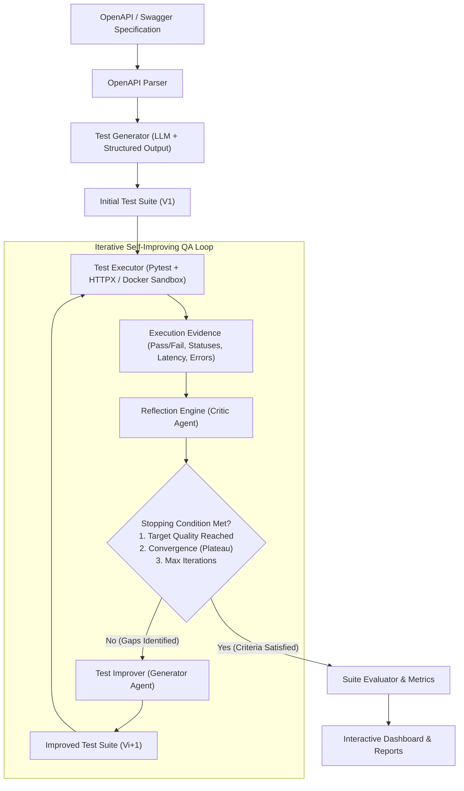

# AI API Testing & Iterative Self-Improving QA Agent

[](https://www.python.org/downloads/)
[](https://www.deeplearning.ai/)
[](https://docs.docker.com/)
[](LICENSE)

An **Agentic AI system** that automatically generates API test cases, executes them against live APIs, analyzes execution evidence, and iteratively improves its test suite through the **Reflection Design Pattern** until predefined quality targets are reached or stopping conditions are satisfied.

> **Core Contribution**: Iterative, execution-grounded reflection for continuous improvement of AI-generated API test suites, decoupling pass rate from test suite quality and expanding scenario coverage across complex edge cases.

---

## 🎯 Overview & Significance

Traditional API testing requires developers and QA engineers to manually construct assertions, imagine subtle boundary conditions, and constantly maintain test suites across frequent schema updates. Simply prompting an LLM once produces shallow "happy-path" tests that often yield a 100% pass rate without actually testing boundaries, input validations, or security requirements.

The **AI API Testing & Iterative Self-Improving QA Agent** solves this by implementing an autonomous, execution-grounded reflection loop:
1. **Parses API Specifications**: Analyzes OpenAPI 3.x / Swagger 2.0 schemas, parameters, query filters, and payload requirements.
2. **Generates Baseline Test Suite ($V_1$)**: Constructs multi-scenario test cases (positive paths, boundary values, empty inputs, type violations, and missing auth).
3. **Executes Tests in Controlled Environment**: Captures real execution evidence (status codes, responses, latencies, failure traces) with optional Docker isolation.
4. **Reflects on Execution Evidence**: Analyzes actual failures, unexpected HTTP statuses (e.g. 500 server crashes), untested parameter paths, and missing scenario categories.
5. **Iteratively Synthesizes Refined Suites ($V_2 \dots V_n$)**: Automatically adds missing edge cases and refines assertions without human intervention.
6. **Enforces Formal Stopping Conditions**: Dynamically terminates when quality targets are achieved, edge-case discovery converges, or iteration budgets are exhausted.
7. **Quantitative Evaluation & Trajectory Tracking**: Delivers comparative metrics tracking suite evolution, coverage growth, and defect detection rate.

---

## 🔄 Reflection Design Pattern Architecture



---

## 🛑 Stopping Conditions & Quality Criteria

The agent halts the improvement cycle automatically when any of the following conditions are met:

| Stopping Condition | Trigger Condition | Rationale |
| :--- | :--- | :--- |
| **`TARGET_REACHED`** | Coverage $\ge$ `TARGET_COVERAGE_PERCENT` (e.g. 90%) and Quality Score $\ge$ `TARGET_QUALITY_SCORE` (e.g. 0.85) | High quality achieved; meets user standards. |
| **`CONVERGENCE`** | Zero net edge cases added and coverage delta $\le 0\%$ across consecutive iterations | Discovery plateaued; further prompting yields diminishing returns. |
| **`MAX_ITERATIONS`** | Reaches `MAX_REFLECTION_ITERATIONS` (default: 3) | Prevents infinite loops and bounds API / computational budget. |

---

## 🛡️ Docker-Based Execution Sandbox

To guarantee security against untrusted code execution, tests can run in an ephemeral, unprivileged Docker container:

- **Isolated Network**: Tests communicate with target APIs safely via host bridge or internal networks.
- **Read-Only Volume Mounts**: Artifact test files are mounted as read-only (`:ro`).
- **Resource Constraints**: Capped at `256MB` RAM and non-root execution (`no-new-privileges:true`).
- **Offline Resilient**: Automatically detects Docker daemon availability and falls back to safe in-process execution when offline.

---

## 📁 Project Directory Structure

```text
ai-api-testing-agent/
│
├── config/                     # Configuration and environment settings
│   ├── __init__.py
│   └── settings.py             # Pydantic BaseSettings for LLM, timeouts, stopping conditions
│
├── core/                       # Core Agentic AI modules
│   ├── __init__.py
│   ├── llm_client.py           # Provider-agnostic LLM interface with structured outputs
│   ├── api_parser.py           # OpenAPI / Swagger specification parser & ref resolver
│   ├── test_generator.py       # Baseline API test case generator (V1)
│   ├── reflection_engine.py    # Analyzes execution evidence, detects gaps, scores quality
│   ├── test_improver.py        # Generates improved test cases for missing edge cases
│   └── loop_orchestrator.py    # Manages iterative loop, callbacks, and stopping criteria
│
├── execution/                  # Test execution environment
│   ├── __init__.py
│   ├── test_executor.py        # Test runner collecting HTTP evidence and latencies
│   └── sandbox.py              # Docker sandbox runner with security constraints
│
├── evaluation/                 # Quantitative evaluation and comparative analytics
│   ├── __init__.py
│   ├── evaluator.py            # Compares V1 vs final suites and generates narrative summaries
│   └── metrics.py              # Coverage delta, defect detection rate, and trajectory metrics
│
├── models/                     # Data schemas and Pydantic models
│   ├── __init__.py
│   └── schemas.py              # Typed domain models (ScenarioType, TestCase, IterationResult, etc.)
│
├── prompts/                    # Structured system and agent prompt templates
│   ├── __init__.py
│   └── templates.py            # Generator, Reflector, and Improver prompts
│
├── storage/                    # Persistent storage for runs and history
│   ├── __init__.py
│   └── history.py              # History manager for reports and test files
│
├── artifacts/                  # Generated artifacts
│   ├── generated_tests/        # Stored Python test files (test_v1_iter1.py, test_v2_iter2.py)
│   └── reports/                # Execution reports and comparison summaries
│
├── examples/                   # Demonstration assets
│   ├── sample_openapi.json     # Complete OpenAPI 3.0 specification for user management
│   └── mock_server.py          # Standalone target API mock server
│
├── tests/                      # Automated unit & E2E test suite (51 passing tests)
│   ├── test_api_parser.py
│   ├── test_end_to_end.py
│   ├── test_evaluation_metrics.py
│   ├── test_executor.py
│   ├── test_generator.py
│   ├── test_llm_client.py
│   ├── test_loop_orchestrator.py
│   ├── test_reflection_engine.py
│   ├── test_reflection.py
│   ├── test_sandbox.py
│   ├── test_schemas.py
│   └── test_test_improver.py
│
├── app.py                      # Streamlit interactive dashboard entry point
├── main.py                     # CLI entry point for running the iterative QA loop
├── requirements.txt            # Python dependencies
├── pyproject.toml              # Pytest and linter configuration
├── Dockerfile                  # Container definition for isolated execution
└── docker-compose.yml          # Compose orchestration
```

---

## 🚀 Quick Start

### 1. Prerequisites
- **Python 3.11+** (or Python 3.9+)
- (Optional) **Docker Desktop** for isolated execution

### 2. Environment Setup
```powershell
# Navigate into repository
cd ai-api-testing-agent

# Create & activate virtual environment
python -m venv venv
.\venv\Scripts\Activate.ps1   # Windows PowerShell
# or: source venv/bin/activate  # Linux/macOS

# Install dependencies
pip install -r requirements.txt

# Configure environment variables
cp .env.example .env
```

### 3. Running the Mock Server (Optional Target API)
```powershell
python examples/mock_server.py
```

### 4. Running the CLI
Run the full self-improving reflection pipeline:
```powershell
python main.py --spec examples/sample_openapi.json --url http://127.0.0.1:8000 --max-iterations 3
```

**CLI Arguments:**
- `--spec`: Path or URL to OpenAPI JSON/YAML specification.
- `--url`: Base URL of target API under test.
- `--max-iterations`: Maximum reflection iterations (default: `3`).
- `--target-coverage`: Target scenario coverage percentage (default: `90.0`).
- `--target-quality`: Target quality score threshold `0.0 - 1.0` (default: `0.85`).
- `--sandbox`: Enable isolated Docker container test execution.

### 5. Running the Streamlit Web Dashboard
Launch the interactive web UI:
```powershell
streamlit run app.py
```

---

## 🧪 Running Automated Tests

Run the full pytest suite:
```powershell
pytest -v
```

All **51 automated tests** pass cleanly, validating:
- OpenAPI parsing & schema extraction
- Multi-scenario baseline test generation
- LLM client error handling & structured output parsing
- Execution engine HTTP evidence collection
- Reflection engine defect detection and gap analysis
- Test improver edge-case generation ($V_1 \to V_2 \dots$)
- Loop orchestrator stopping conditions (`TARGET_REACHED`, `CONVERGENCE`, `MAX_ITERATIONS`)
- Docker sandbox security boundaries and offline fallback
- Quantitative trajectory evaluation metrics
- End-to-end integration across live mock API, CLI, and offline resilience
